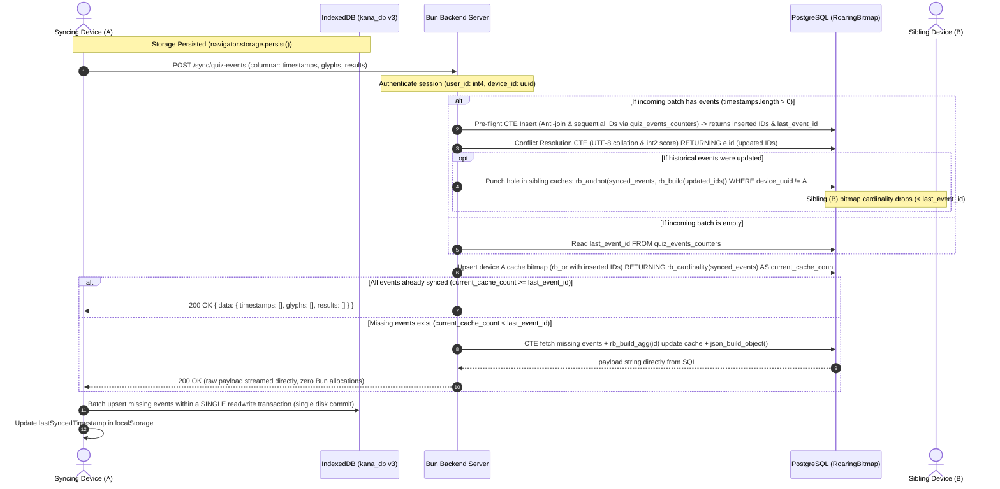

# Synchronization & Storage Optimization Refactor Pass

## Goal Description
Refactor the full-stack synchronization system across `@kana/helpers`, `backend`, and `web` to maximize efficiency on constrained backend resources and eliminate redundant data transfer.

Key improvements:
1. **Columnar Wire Protocol & Zero-Allocation Serialization**: Replace array-of-objects with columnar arrays (`timestamps: int8[]`, `glyphs: text[]`, `results: int2[]`). On the backend, use `sql.array` with `unnest()` and build missing-event JSON directly inside PostgreSQL (`json_build_object`), returning the raw payload directly to HTTP responses without allocating JavaScript intermediate objects.
2. **Roaring Bitmap Device Tracking & Piggybacked Cardinality**: Track each device's synced events using `roaringbitmap` in `quiz_events_devices_cache`. Piggyback cardinality calculation onto the Device Cache Upsert query via `RETURNING rb_cardinality(synced_events) AS current_cache_count`. Skip the missing events query completely whenever `current_cache_count >= last_event_id`.
3. **Event Mutability via Sibling Cache Punching (`rb_andnot`)**: When historical events are updated via conflict resolution, return their IDs (`RETURNING e.id`) and subtract them from all other device caches owned by that user (`UPDATE quiz_events_devices_cache SET synced_events = rb_andnot(synced_events, rb_build($updated_ids)) WHERE user_id = $user_id AND device_uuid != $device_id`). This drops sibling cache counts below `last_event_id`, ensuring modified events are delivered on sibling syncs without abandoning Roaring Bitmaps.
4. **Single-Transaction IndexedDB Batch Commit**: Eliminate per-record transactions when applying missing events on the client by executing all `store.put()` calls inside a single `readwrite` IndexedDB transaction, committing to disk exactly once.
5. **Optimized Conflict Resolution & Collation Match**: Change `result` from string (`'correct' | 'wrong' | 'skipped'`) to `int2` (`CORRECT = 3`, `WRONG = 2`, `SKIPPED = 1`). Implement zero-allocation UTF-8 byte-order collation comparison (`compareCollateC`) in TypeScript to identically match PostgreSQL's `COLLATE "C"`.
6. **Device ID Lifecycle**: Support optional `device_id` during register and login. Set a permanent, HTTP-only, secure cookie with `device_id` (trusted over localStorage), embed `device_id` in encrypted session tokens, and persist it to `localStorage` as client fallback. Logout never clears `device_id`. All UUIDv7s are generated using Bun's native `randomUUIDv7()` from `'bun'`.
7. **Strict User ID Isolation**: Internal `int4` user ID is strictly private to the server (never returned or exposed to the client). Sessions securely seal it in encrypted cookies.
8. **IndexedDB v3 Migration & Storage Persistence**: Migrate IndexedDB `kana_db` to version 3, converting existing string results to integers. Call `navigator.storage.persist()` on DB initialization to prevent browser data eviction.
9. **Background Cron Eviction**: Register an in-process daily cron (`Bun.cron("@daily", ...)`) on the backend to evict device caches inactive for more than 30 days.
10. **100% Test Coverage Across All 4 Metrics**: Adhere to the 3-pillar testing methodology, ensuring all tests pass in isolation with 100% lines, functions, branches, and statements coverage.

---

## User Review Required

> [!IMPORTANT]
> **Key Architecture Decisions Implemented:**
> - Synchronization payload replaces `{ items: QuizEvent[], totalItems: number }` with columnar `{ timestamps: number[], glyphs: string[], results: number[] }`.
> - Synchronization response returns `ServerResponse<{ timestamps: number[], glyphs: string[], results: number[] }>` generated directly in PostgreSQL. When no events are missing, Bun responds immediately with empty arrays.
> - Modified events propagate via `rb_andnot` cache punching on sibling devices.
> - IndexedDB writes all synced events inside a single `readwrite` transaction.
> - `DEVICE_ID_COOKIE_NAME` is loaded from environment variables (no `.default()` in schema) with a 10-year max-age (315,360,000s), `HttpOnly`, `Secure`, `SameSite=Lax`.
> - `randomUUIDv7` from `bun` is used for all device UUID generation.
> - Internal `int4` user ID is strictly concealed from the client.

---

## Architecture Flow



---

## Proposed Changes

### Component 1: Shared Helpers (`packages/helpers`)

#### [MODIFY] [`packages/helpers/src/sync/schemas.ts`](file:///Users/patrick/Documents/GitHub/kana/packages/helpers/src/sync/schemas.ts)
- Define `QUIZ_RESULT = { SKIPPED: 1, WRONG: 2, CORRECT: 3 } as const` and `quizResultSchema = z.union([z.literal(1), z.literal(2), z.literal(3)])`.
- Update `QuizEvent`: `{ glyph: string, timestamp: number, result: QuizResult }`.
- Define columnar request schema `syncQuizEventsPayloadSchema`:
  - `timestamps: z.array(z.number().int().positive())`
  - `glyphs: z.array(z.string().min(1).max(MAX_GLYPH_LENGTH))`
  - `results: z.array(quizResultSchema)`
  - Refinement ensuring all 3 arrays have identical lengths.
- Define columnar response data schema `syncQuizEventsDataSchema`.
- Export `SyncQuizEventsPayload`, `SyncQuizEventsData`, `SyncQuizEventsResponse`.

#### [MODIFY] [`packages/helpers/src/auth/schemas.ts`](file:///Users/patrick/Documents/GitHub/kana/packages/helpers/src/auth/schemas.ts)
- Update `tokenDataSchema`:
  - `user_id: z.number().int().positive()` (replacing `z.uuid()`)
  - `device_id: z.uuid()`
  - `expires_at: z.iso.datetime()`
- Update `registerSchema` and `loginCredentialsSchema` to optionally accept `device_id: z.uuid().optional()`.
- Ensure `userSchema` only contains `email`, `name`, `expires_at` (never internal `user_id`).

#### [MODIFY] [`packages/helpers/src/sync/schemas.test.ts`](file:///Users/patrick/Documents/GitHub/kana/packages/helpers/src/sync/schemas.test.ts)
- Test columnar schemas, length matching refinement, integer quiz results, and edge cases for 100% coverage.

#### [MODIFY] [`packages/helpers/src/auth/schemas.test.ts`](file:///Users/patrick/Documents/GitHub/kana/packages/helpers/src/auth/schemas.test.ts)
- Update tests for `tokenDataSchema` with numeric `user_id` and UUID `device_id`.

---

### Component 2: Backend Core & Authentication (`packages/backend`)

#### [MODIFY] [`packages/backend/app/helpers/config.server.ts`](file:///Users/patrick/Documents/GitHub/kana/packages/backend/app/helpers/config.server.ts)
- Add `DEVICE_ID_COOKIE_NAME: z.string().trim().min(1)` (without `.default()`).
- Add `DEVICE_COOKIE_MAX_AGE_SECONDS = 315360000` (10 years).

#### [MODIFY] [`packages/backend/app/helpers/auth/cookie.server.ts`](file:///Users/patrick/Documents/GitHub/kana/packages/backend/app/helpers/auth/cookie.server.ts)
- Implement `getDeviceIdCookie(req: BunRequest): string | undefined`.
- Implement `attachDeviceIdCookie(req: BunRequest, res: Response, deviceId: string): void`.
- Ensure `deleteSessionCookie` only expires `SESSION_COOKIE_NAME` and `VITE_SESSION_COOKIE_DATA_NAME`, preserving the `device_id` cookie.

#### [MODIFY] [`packages/backend/app/helpers/auth/register.server.ts`](file:///Users/patrick/Documents/GitHub/kana/packages/backend/app/helpers/auth/register.server.ts)
- Update internal `UserRecord`: `id: number` (`int4`), `email: string`, `name: string`.
- Accept optional `deviceId?: string`. If omitted, generate using Bun's `randomUUIDv7()` from `'bun'`.
- On insert into `users`:
  - Insert into `quiz_events_counters (user_id, last_event_id) VALUES (user.id, 0)`.
- Mint session token with `{ user_id: user.id, device_id: deviceId, expires_at: expiresAt }`.
- Return `{ user: { email: user.email, name: user.name }, device_id: deviceId, token, expires_at }`. No `user_id` exposed.

#### [MODIFY] [`packages/backend/app/helpers/auth/login.server.ts`](file:///Users/patrick/Documents/GitHub/kana/packages/backend/app/helpers/auth/login.server.ts)
- Accept optional `deviceId?: string`.
- For credential login: use provided `deviceId` or fallback to generated `randomUUIDv7()`.
- For refresh token login: retrieve `tokenData.device_id` (fallback to provided `deviceId` or generated).
- Update query `WHERE id = ${user.id}` (integer, remove `::uuid`).
- Mint session token with `{ user_id: user.id, device_id: deviceId, expires_at: expiresAt }`.
- Return `{ user: { email: user.email, name: user.name }, device_id: deviceId, token, expires_at }`. No `user_id` exposed.

#### [MODIFY] [`packages/backend/app/routes/auth/route.server.ts`](file:///Users/patrick/Documents/GitHub/kana/packages/backend/app/routes/auth/route.server.ts)
- In `POST /auth/register` and `POST /auth/login`:
  - Check `getDeviceIdCookie(req) ?? form.data.device_id`.
  - Pass resolved `deviceId` to `register`/`login`.
  - Call `attachDeviceIdCookie(req, res, result.data.device_id)`.
  - Return `device_id` in the response JSON so the client can cache it. No `user_id` returned.
- Fix oxlint `await-thenable` in test for logout.

---

### Component 3: Backend Synchronization & Device Cache (`packages/backend`)

#### [MODIFY] [`packages/backend/app/helpers/sync/quiz-events.server.ts`](file:///Users/patrick/Documents/GitHub/kana/packages/backend/app/helpers/sync/quiz-events.server.ts)
- Function signature: `syncQuizEvents({ data, user_id, device_id }: { data: SyncQuizEventsPayload; user_id: number; device_id: string })`.
- Within a transaction:
  1. **Batch Insert CTE (when `data.timestamps.length > 0`)**:
     - Anti-join via `unnest($1::int8[], $2::text[], $3::int2[])` against `quiz_events (user_id, timestamp)`.
     - Lock counter row: `UPDATE quiz_events_counters SET last_event_id = last_event_id + (SELECT count(*) FROM new_events) WHERE user_id = $4 RETURNING last_event_id, (last_event_id - (SELECT count(*) FROM new_events)) AS start_id`.
     - Sequential ID insert into `quiz_events (user_id, id, timestamp, glyph, result) ... RETURNING id`.
     - Capture `last_event_id` and `insertedIds`.
  2. **If `data.timestamps.length === 0`**:
     - Retrieve `last_event_id` via `SELECT last_event_id FROM quiz_events_counters WHERE user_id = ${user_id}`.
  3. **Conflict Resolution CTE with `RETURNING e.id` (when `data.timestamps.length > 0`)**:
     ```sql
     WITH incoming AS (
       SELECT * FROM unnest(
         ${tx.array(data.timestamps, 'int8')},
         ${tx.array(data.glyphs, 'text')},
         ${tx.array(data.results, 'int2')}
       ) AS i(timestamp, glyph, result)
     )
     UPDATE quiz_events e
     SET 
       glyph = i.glyph,
       result = i.result
     FROM incoming i
     WHERE e.user_id = ${user_id}
       AND e.timestamp = i.timestamp
       AND (i.glyph > e.glyph OR (i.glyph = e.glyph AND i.result > e.result))
     RETURNING e.id;
     ```
  4. **Sibling Cache Eviction (`rb_andnot`)**:
     - If `updatedRows.length > 0`:
       ```sql
       UPDATE quiz_events_devices_cache
       SET synced_events = rb_andnot(synced_events, rb_build(${tx.array(updatedIds, 'int4')}))
       WHERE user_id = ${user_id} AND device_uuid != ${device_id};
       ```
  5. **Device Cache Upsert with Piggybacked Cardinality**:
     ```sql
     INSERT INTO quiz_events_devices_cache (device_uuid, user_id, last_synced_at, synced_events)
     VALUES (${device_id}, ${user_id}, CURRENT_DATE, rb_build(${tx.array(insertedIds, 'int4')}))
     ON CONFLICT (user_id, device_uuid) DO UPDATE 
     SET 
         synced_events = rb_or(quiz_events_devices_cache.synced_events, EXCLUDED.synced_events),
         last_synced_at = CURRENT_DATE
     RETURNING rb_cardinality(synced_events) AS current_cache_count;
     ```
  6. **Fast Cardinality Check**:
     - If `current_cache_count >= last_event_id`: no events are missing! Return `{ rawPayload: null }`.
  7. **Direct SQL JSON Generation**:
     - If `current_cache_count < last_event_id`: execute the CTE that filters `NOT rb_contains(synced_events, id)`, updates the cache bitmap with `rb_build_agg(id)`, and aggregates directly to `{ data: { timestamps: [...], glyphs: [...], results: [...] } }::text AS payload`.
     - Return `{ rawPayload: payload }`.

#### [MODIFY] [`packages/backend/app/routes/sync/route.server.ts`](file:///Users/patrick/Documents/GitHub/kana/packages/backend/app/routes/sync/route.server.ts)
- Enforce authentication -> retrieve `{ user_id, device_id }`.
- Parse body using `syncQuizEventsPayloadSchema`.
- Call `syncQuizEvents`.
- If `result.rawPayload`: return `new Response(result.rawPayload, { headers: { 'Content-Type': 'application/json' }, status: HTTP_OK })` (zero allocations in Bun).
- Else: return `Response.json({ data: { timestamps: [], glyphs: [], results: [] } }, { status: HTTP_OK })`.

#### [NEW] [`packages/backend/app/helpers/cron.server.ts`](file:///Users/patrick/Documents/GitHub/kana/packages/backend/app/helpers/cron.server.ts)
- Export `evictExpiredDeviceCaches(): Promise<number>`:
  - `DELETE FROM quiz_events_devices_cache WHERE last_synced_at < CURRENT_DATE - INTERVAL '30 days'`.
- Export `registerDailyCacheEvictionCron(): void`:
  - Registers `Bun.cron("@daily", () => evictExpiredDeviceCaches())`.

#### [MODIFY] [`packages/backend/app/index.server.ts`](file:///Users/patrick/Documents/GitHub/kana/packages/backend/app/index.server.ts)
- Call `registerDailyCacheEvictionCron()`.

---

### Component 4: Web Frontend Core, IDB v3 & UI (`packages/web`)

#### [MODIFY] [`packages/web/app/types/quiz.ts`](file:///Users/patrick/Documents/GitHub/kana/packages/web/app/types/quiz.ts)
- Import `QUIZ_RESULT` and `QuizResult` from `@kana/helpers/sync/schemas`.
- Export `QuizEvent`: `{ glyph: string; timestamp: number; result: QuizResult }`.

#### [MODIFY] [`packages/web/app/helpers/resolve-event-collision.ts`](file:///Users/patrick/Documents/GitHub/kana/packages/web/app/helpers/resolve-event-collision.ts)
- Implement `compareCollateC(a: string, b: string): number` with zero-allocation UTF-8 byte-order code point comparison.
- Implement `resolveEventCollision(a: QuizEvent, b: QuizEvent): QuizEvent`:
  - 1. If glyphs differ: `compareCollateC(a.glyph, b.glyph) > 0 ? a : b`.
  - 2. If glyphs match: `a.result !== b.result ? (a.result > b.result ? a : b) : a`.

#### [MODIFY] [`packages/web/app/helpers/get-db.ts`](file:///Users/patrick/Documents/GitHub/kana/packages/web/app/helpers/get-db.ts)
- Bump `DB_VERSION = 3`.
- In `executeGetDb()`: call `navigator.storage?.persist?.().catch(() => {})`.
- Migration:
  - If existing version is 1: read legacy records with `id`, deduplicate by collision resolution, convert string results to integers (`correct` -> 3, `wrong` -> 2, `skipped` -> 1), populate v3 store.
  - If existing version is 2: read v2 records with `getAll()`, convert string results to integers (`correct` -> 3, `wrong` -> 2, `skipped` -> 1), populate v3 store.

#### [MODIFY] [`packages/web/app/helpers/sync-storage.ts`](file:///Users/patrick/Documents/GitHub/kana/packages/web/app/helpers/sync-storage.ts)
- Add `getDeviceId(): string | null` and `setDeviceId(id: string): void` reading and writing to `localStorage.getItem('device_id')`.

#### [MODIFY] [`packages/web/app/endpoints/auth/login.ts`](file:///Users/patrick/Documents/GitHub/kana/packages/web/app/endpoints/auth/login.ts) & [`register.ts`](file:///Users/patrick/Documents/GitHub/kana/packages/web/app/endpoints/auth/register.ts)
- Append `device_id` from `getDeviceId()` into `formData` if present and not already attached.
- Response type receives `User & { device_id: string }`.
- Save returned `device_id` to `setDeviceId(...)`.

#### [MODIFY] [`packages/web/app/endpoints/sync/quiz-events.ts`](file:///Users/patrick/Documents/GitHub/kana/packages/web/app/endpoints/sync/quiz-events.ts)
- Update props to `SyncQuizEventsPayload` and response to `SyncQuizEventsResponse`.

#### [MODIFY] [`packages/web/app/helpers/sync-quiz-events.ts`](file:///Users/patrick/Documents/GitHub/kana/packages/web/app/helpers/sync-quiz-events.ts)
- Filter `allEvents` by `lastTimestamp > 0`.
- Construct columnar arrays using a single loop:
  `const timestamps: number[] = []; const glyphs: string[] = []; const results: number[] = [];`
- Call `syncQuizEvents({ timestamps, glyphs, results })`.
- Single-pass iterate over response columnar arrays (`timestamps`, `glyphs`, `results`) to batch upsert missing events into IndexedDB inside a **single `readwrite` transaction**:
  ```ts
  await new Promise<void>((resolve, reject) => {
    const tx = db.transaction([STORE_NAME], 'readwrite');
    const store = tx.objectStore(STORE_NAME);
    tx.oncomplete = () => resolve();
    tx.onerror = () => reject(tx.error ?? new Error('Failed to upsert missing events'));
    tx.onabort = () => reject(tx.error ?? new Error('Transaction aborted'));

    for (let i = 0; i < missing.timestamps.length; i++) {
      store.put({
        timestamp: missing.timestamps[i]!,
        glyph: missing.glyphs[i]!,
        result: missing.results[i]!,
      });
    }
  });
  ```
- Update `lastSyncedTimestamp`.

#### [MODIFY] [`packages/web/app/helpers/append-quiz-event.ts`](file:///Users/patrick/Documents/GitHub/kana/packages/web/app/helpers/append-quiz-event.ts)
- Store `result: QUIZ_RESULT.SKIPPED` (1).

#### [MODIFY] [`packages/web/app/helpers/update-quiz-event.ts`](file:///Users/patrick/Documents/GitHub/kana/packages/web/app/helpers/update-quiz-event.ts)
- Accept `result: typeof QUIZ_RESULT.CORRECT | typeof QUIZ_RESULT.WRONG`.

#### [MODIFY] [`packages/web/app/helpers/calculate-glyph-score.ts`](file:///Users/patrick/Documents/GitHub/kana/packages/web/app/helpers/calculate-glyph-score.ts) & [`is-practiced-today.ts`](file:///Users/patrick/Documents/GitHub/kana/packages/web/app/helpers/is-practiced-today.ts)
- Update comparisons to use `QUIZ_RESULT.SKIPPED`, `QUIZ_RESULT.WRONG`, `QUIZ_RESULT.CORRECT`.

#### [MODIFY] [`packages/web/app/routes/quiz/route.tsx`](file:///Users/patrick/Documents/GitHub/kana/packages/web/app/routes/quiz/route.tsx)
- Call `updateQuizEvent(timestamp, QUIZ_RESULT.CORRECT)` / `updateQuizEvent(timestamp, QUIZ_RESULT.WRONG)`.

#### [MODIFY] [`packages/web/app/routes/sign-in/route.tsx`](file:///Users/patrick/Documents/GitHub/kana/packages/web/app/routes/sign-in/route.tsx) & [`create-account/route.tsx`](file:///Users/patrick/Documents/GitHub/kana/packages/web/app/routes/create-account/route.tsx)
- In `clientAction`, ensure `device_id` from `getDeviceId()` is included in submission, and save returned `device_id`.

---

## Verification Plan

### Automated Tests
1. **Helpers Validation & Coverage**:
   - `bun --filter @kana/helpers check`
   - `bun --filter @kana/helpers test` (Verify 100% across lines, functions, branches, statements).
2. **Backend Logic & Database Tests**:
   - `bun --filter backend check` (Static checks: typecheck, oxfmt, oxlint).
   - `bun --filter backend test app/helpers/auth/login.server.db.test.ts`
   - `bun --filter backend test app/helpers/auth/register.server.db.test.ts`
   - `bun --filter backend test app/helpers/sync/quiz-events.server.db.test.ts` (Includes multi-device sync with sibling cache eviction verification).
   - `bun --filter backend test app/helpers/cron.server.test.ts`
   - `bun --filter backend test` (All backend tests passing with 100% coverage).
3. **Web Frontend Tests**:
   - `bun --filter web check`
   - `bun --filter web test app/helpers/get-db.test.ts`
   - `bun --filter web test app/helpers/resolve-event-collision.test.ts`
   - `bun --filter web test app/helpers/sync-quiz-events.test.ts`
   - `bun --filter web test` (All 42+ test files passing with 100% coverage).

### Manual Verification
- Verify that device ID cookie is set on login/register and remains intact after logout.
- Multi-device sync scenario:
  - Device 1 performs quiz (results initially skipped, then updated to correct) and syncs.
  - Device 2 syncs: receives all events.
  - Device 1 modifies historical event (e.g. from wrong to correct) and syncs.
  - Device 2 syncs again: receives updated event via sibling hole punching (`rb_andnot`).
  - Subsequent sync with no modifications receives empty missing arrays.
